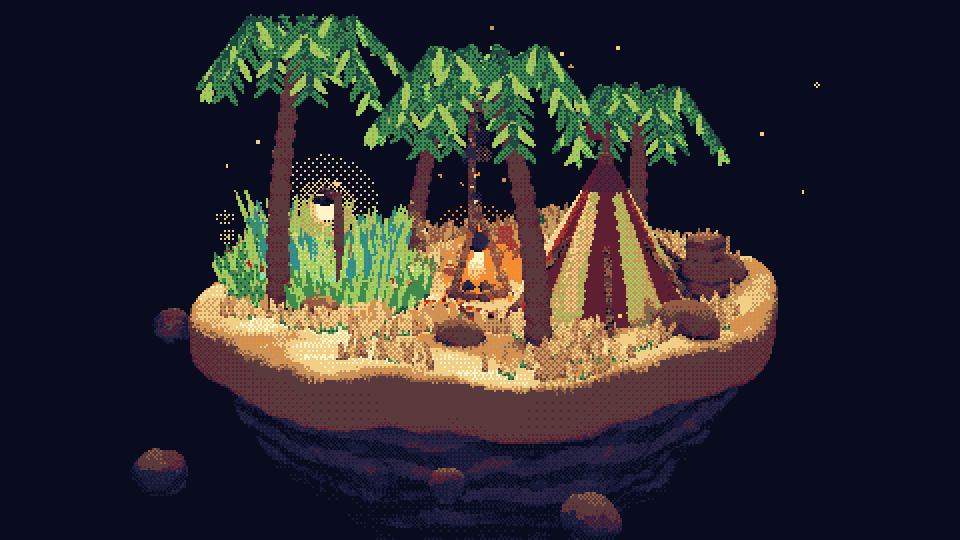
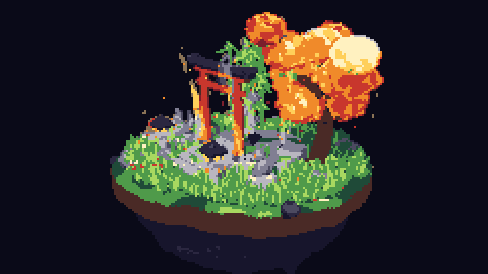
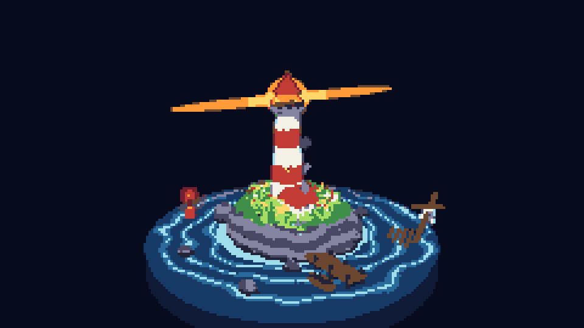
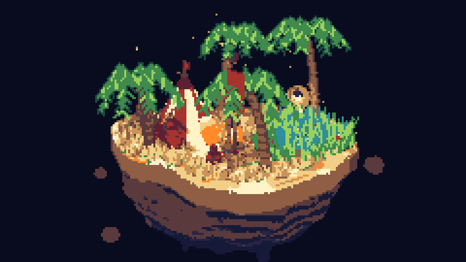
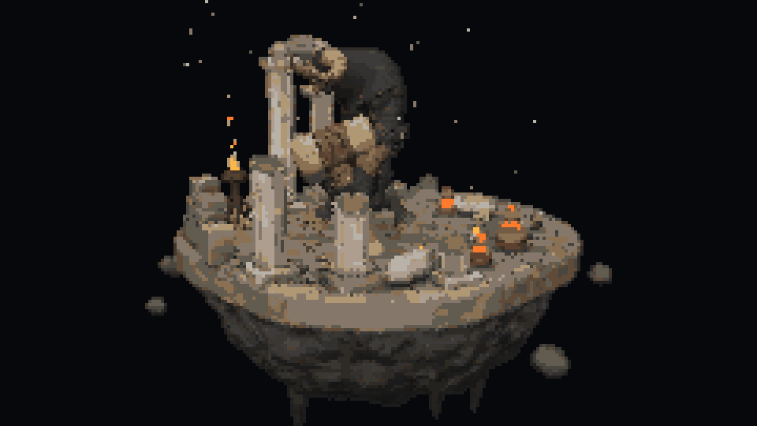
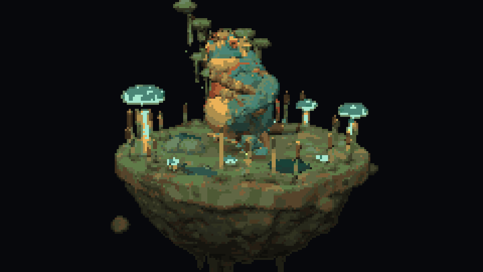
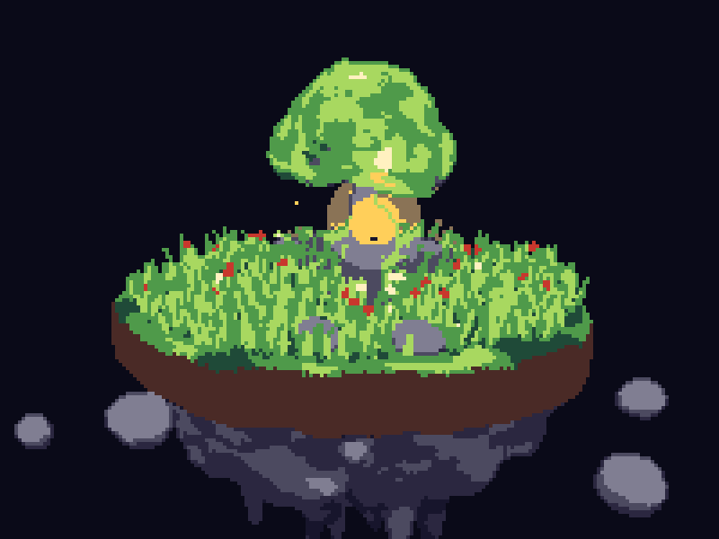
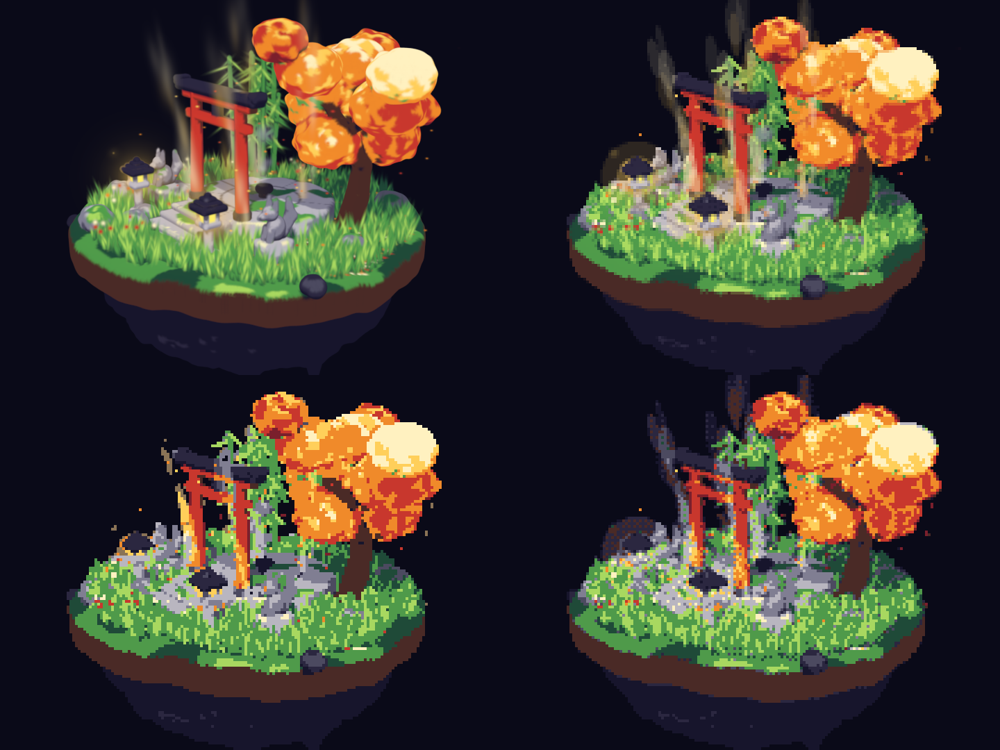

# pixelart-gaussiansplat

Pixel-art Gaussian splats in the browser. Real 3D you can orbit, drawn as crisp pixel art with a small palette and dark outlines.



| | | |
|---|---|---|
|  |  |  |
|  |  |  |

It contains:

- **A viewer** built on [three.js](https://threejs.org) and [Spark](https://github.com/sparkjsdev/spark).
- **Scenes written in code**: an island, shapes, grass, lights and particles in one short file.
- **A converter for ordinary 3D models** (glTF / GLB), including rigged ones that keep their animations.
- **The examples above**, ready to open.

## Quick start

```bash
git clone https://github.com/cobanov/pixelart-gaussiansplat
cd pixelart-gaussiansplat
npm install
npm run dev
```

Open the address Vite prints. Drag to orbit, scroll to zoom. The panel on the left switches examples and changes the look (pixel size, dither, palette, supersampling, outlines).

Requires Node 20.19 or newer (22.12 or newer on the 22 line) and a browser with WebGL 2.

## How it works

The splats are ordinary Gaussian splats; the pixel art comes from how they are drawn.



1. **Splats as surfels** (top left). Every splat is a flat disc lying on a surface. Its rotation stores the surface normal.
2. **Light baked into scenes.** A scene does not move, so its light is worked out once per splat at build time: soft sun shadows marched through the distance field, lamps that only light what they can see, leaves that let light through. The colour is then picked from the palette within the surface's own hue, with cool shadows and warm light. Converted models, which move, are lit on the GPU every frame.
3. **Small and hard** (top right). The scene is drawn at twice the art resolution, with the Gaussian falloff switched off. Each 2×2 block becomes one art pixel: object or background, by coverage.
4. **A palette by vote** (bottom left). Each sample snaps to its nearest palette colour and the pixel takes the one most samples chose, so no pixel is an average of two materials.
5. **Outlines and light.** A pixel on the silhouette takes a darker shade of its own colour. Translucent light (sun shafts, halos, smoke) is blended over the background and snapped to the palette in its own hue, so a beam is a flat band of muted colour.

Ordered dithering (bottom right) is still there, on the `dither` slider, but off by default.

The pixel grid is fixed to the screen, so zooming never changes the size of a pixel.

[docs/how-it-works.md](docs/how-it-works.md) goes through each step, with the files to read.

## Make your own

### A scene

A scene is one JavaScript file. The starter, [`src/authoring/scenes/hello.js`](src/authoring/scenes/hello.js), is about 60 lines: an island, a tree, a lantern, 1,500 blades of grass.

```bash
npm run scene hello     # builds public/models/hello.dio, about two seconds
```

[docs/make-a-scene.md](docs/make-a-scene.md) walks through it.

### A model

Any glTF or GLB file works: a scan, a sculpt, a model from a generator.

```bash
npm run convert path/to/model.glb mymodel      # the model, as splats
npm run island mymodel ruins                   # optional: something to stand on
```

Then open `/?m=mymodel`. If the model has a skeleton and animation clips, they play. Island themes: `ruins`, `desert`, `swamp`, `crag`, `dais`.

[docs/bring-your-own-model.md](docs/bring-your-own-model.md) has the details.

## Layout

```
src/
  viewer.js            the viewer: loads an example, runs the frame loop
  viewer/              loaders: models, skeletons, worlds, automatic palettes
  render/              the look: pixel pass, per-splat lighting, particles, the panel
  authoring/           what scenes are written with (runs in Node, not in the browser)
    sdf.js               signed-distance shapes and the surface sampler
    island.js            the island, shared props, the bake step
    scene-kit.js         grass, leaves, glows
    themes.js            islands for models
    scenes/              one file per scene
  angler/              a creature modelled and rigged entirely in code
tools/                 build-scene, convert-model, build-island
public/models/         the built examples
```

## Credits

- [Spark](https://github.com/sparkjsdev/spark) by World Labs renders the splats and runs the per-splat shaders.
- [three.js](https://threejs.org) does everything else in the browser, and [glTF Transform](https://gltf-transform.dev) reads models in the converter.
- The idea of pixel-art splat dioramas came from posts by [Silicon Jungle](https://x.com/JungleSilicon).

## License

The code is MIT licensed, see [LICENSE](LICENSE).

The scenes are generated by the code in this repository and fall under the same license. The converted creature models in `public/models` (minotaur, toad, vulture, hyena, dragon shield) come from the game Kervan and are included as examples only; they are not covered by the MIT license.
