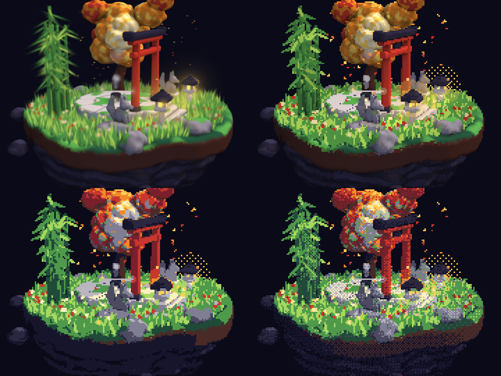

# How it works

Each section names the file that does the work. They are all short.

## 1. Splats as surfels

A Gaussian splat has a position, a size along three axes, a rotation and a colour. Here every splat is a **surfel**: wide in two directions, thin in the third, lying flat on a surface.

- The thin axis is the surface normal. No extra storage is needed: the normal is read back from the splat's rotation.
- Splats sit on a regular spacing `h` and are `0.66 h` wide, so neighbours overlap and the surface has no holes.

Where they come from:

- **Scenes** are built from signed-distance shapes, and the sampler in [`src/authoring/sdf.js`](../src/authoring/sdf.js) walks a grid, keeps the cells the surface passes through and nudges each point onto the surface.
- **Models** are triangle meshes, and [`tools/convert-model.mjs`](../tools/convert-model.mjs) scatters points over the triangles and reads the texture colour at each one.

## 2. Lighting each splat

[`src/render/shade.js`](../src/render/shade.js)

Spark lets you attach a small shader, a *modifier*, that runs for every splat before it is drawn. The lighting modifier:

1. reads the normal from the splat's rotation,
2. adds ambient light, one directional light and up to four point lights (fires, lanterns),
3. fades distant splats towards the background,
4. writes the lit colour back.

Because the normal travels with the splat, lighting stays right when a skeleton bends the model.

A few flags (emissive, two-sided) are packed into the opacity channel. Hard-edged splats are fully opaque, so the channel is otherwise unused.

## 3. The pixel pass

[`src/render/post.js`](../src/render/post.js), and `applyCrisp` in [`src/render/hud.js`](../src/render/hud.js)

**Low resolution.** The splats are drawn into a small render target. With a pixel size of 4, a 1600×900 window renders at 400×225. A full-screen pass then reads it with nearest sampling, so one texel becomes one square on screen. The grid belongs to the screen, not the scene: zooming changes what is in each pixel, never how big a pixel is.

**Hard splats.** Normally a splat fades out towards its edge and blends with what is behind it. That blending is what makes splats look soft, and after palette snapping it reads as noise. So the falloff is switched off (`falloff: 0`) and each splat is a solid disc.

**Alpha test, not alpha blend.** A pixel is either the object's colour or the background. The decision is made against a 4×4 Bayer pattern, which has two effects: silhouettes are hard, and anything deliberately translucent (a glow, smoke, a light beam) turns into a dot pattern whose density follows its opacity.

**Palette.** Every pixel is matched to a short list of colours. Scenes carry their own palette of about 15 colours. For a converted model, [`src/viewer/palette.js`](../src/viewer/palette.js) derives one with k-means over the model's colours at the brightness levels the lighting produces.

**Dithering.** With the `dither` control at 0, a pixel takes the nearest palette colour. Above 0, the pass finds the *two* nearest colours, measures where the pixel sits between them, and picks one or the other using the Bayer pattern in that proportion. A smooth gradient between two palette colours becomes a checkerboard that thins out towards each end.

## 4. Scenes

[`src/authoring/`](../src/authoring), built by [`tools/build-scene.mjs`](../tools/build-scene.mjs)

A scene has three kinds of content.

- **Surfels from shapes.** The island, buildings and trees are signed-distance shapes (spheres, boxes, cones, combinations of them). Each has a material number, and a `paint` function turns material, position and normal into a colour: stripes on a tent, joints between flagstones, moss on anything facing up.
- **Free splats.** Some things are easier to place one splat at a time. A grass blade is a single splat stretched along the blade. A fallen leaf is one flattened splat. A glow is three nested translucent splats, which the alpha test turns into a halo of dots.
- **Particles.** Embers, fireflies, falling leaves, smoke. Each kind is a few lines of GLSL in [`src/render/particles.js`](../src/render/particles.js) that move a splat from its index and the time, so nothing is animated in JavaScript.

Building takes a few seconds, which is why scenes are baked to a file (`.dio`) instead of being built in the browser.

## 5. Rigged models

[`src/viewer/rig.js`](../src/viewer/rig.js)

The converter keeps four joint weights per splat and saves the skeleton and its clips to a small `.rig.glb`. In the browser three.js plays the clips, and each frame the bone poses are handed to Spark's dual-quaternion skinning, which moves every splat on the GPU and rotates it with the bone.

## 6. Islands for models

[`tools/build-island.mjs`](../tools/build-island.mjs), [`src/authoring/themes.js`](../src/authoring/themes.js)

Dropping a walking creature onto a decorated island raises two problems.

- **Limbs pass through props.** The tool plays every clip and records how far the creature reaches in each direction. Tall props go in the directions it reaches least, outside that reach.
- **Feet float or sink.** The middle of the island is flat. Each frame the viewer finds the height the pose stands at and moves the creature so that height meets the ground. It uses the 2nd percentile of splat heights, not the minimum, so a sword tip hanging below the feet does not lift the whole creature.

## Things that cost time

- **Colours came out dark.** Spark converts splat colours to linear space when it draws into a render target. The pixel pass converts back before matching the palette.
- **Skinned models collapsed.** `SplatSkinning.setBoneQuatPos` treats bones as if they rested at the origin. `rig.js` writes each bone's dual quaternion into the bone texture itself.
- **Video blurs odd pixel sizes.** Most video is stored with colour at half resolution. Record with an even pixel size (4 or 6) and edges stay sharp.
