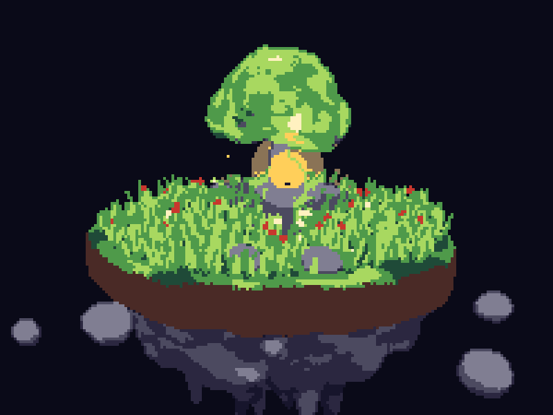

# Make a scene

A scene is a file in `src/authoring/scenes/` that exports a `label` and a `build(rnd)` function. This page follows the starter scene, [`hello.js`](../src/authoring/scenes/hello.js).



## Try it

```bash
npm run dev             # in one terminal
npm run scene hello     # in another; rebuilds public/models/hello.dio
```

Open `/?s=hello`. Change something in `hello.js`, run `npm run scene hello` again and reload.

To start your own, copy `hello.js` to `myscene.js` and add it to [`scenes/index.js`](../src/authoring/scenes/index.js):

```js
import * as myscene from "./myscene.js";
export const SCENES = { hello, caravan, lighthouse, shrine, myscene };
```

## Units

`y = 0` is the ground in the middle of the island and `+y` is up. A converted model is 2 units tall, so a 1.5-unit tree is about three quarters of a character's height. Splats sit 0.02 apart, so shapes thinner than about 0.01 may come out with gaps.

## 1. The context

```js
const c = makeCtx(1.3, 0.3, () => 0.7, rnd), { s } = c, free = makeFree(c);
```

- `1.3` is the island's radius.
- `0.3` is the radius of the flat patch in the middle. Bumps and dunes start outside it.
- `() => 0.7` keeps randomly scattered props (`rocks`, `tufts`) at least that far from the centre.
- `rnd` is a seeded random number generator. Use it instead of `Math.random()` and the scene builds the same way every time.
- `s` is the shape you add to. `free` collects free splats.

## 2. The island

```js
const M = { grass: 0, rock: 1, trunk: 2, leaves: 3, post: 4, lamp: 5 };
island(c, M.grass, M.rock, { bump: 0.03 });
```

Materials are plain numbers. `island` adds a slab with the first material on top and a rough rock underside in the second. Options:

| Option | Effect |
|---|---|
| `bump` | small unevenness outside the flat patch |
| `rise` | how much the ground climbs towards the rim (dunes, ledges) |
| `ripple` | fine ripples, for sand |
| `topY` | height of the island's top, for a raised platform in the middle |

## 3. Shapes

```js
s.add(cone([0, -0.05, 0], [0.05, 0.75, 0], 0.09, 0.05), M.trunk);
s.add(displace(ellipsoid(x, y, z, r, r * 0.8, r), noise), M.leaves, 0.08);
```

`s.add(shape, material, blend)` unions a shape into the scene. `blend` rounds the join with what is already there. `s.sub(shape, material)` carves a shape out; the carved surface gets that material, which is how the pond and the lit doorway in the caravan scene are made.

Shapes, from [`sdf.js`](../src/authoring/sdf.js):

| Shape | Arguments |
|---|---|
| `sphere` | centre x, y, z, radius |
| `ellipsoid` | centre x, y, z, radii x, y, z |
| `box` | centre x, y, z, half sizes x, y, z, corner radius |
| `cyl` | centre x, y, z, radius, half height, corner radius (upright) |
| `cone` | from point, to point, radius at each end (a capsule when equal) |
| `displace(shape, fn)` | adds `fn(x, y, z)` to a shape's distance, for rough surfaces |

Call `c.grow(y)` with the height of anything tall, so the camera frames it.

When a scene has many small props, wrap each in `s.bound(x, y, z, radius)` … `s.bound()`. Shapes inside a bound are skipped for points far from it, which keeps the build fast.

## 4. Free splats

```js
free.grass(1500, () => true, { colors: [[dark, light], [dark2, light2]], r: 1.25 });
free.dots(40, () => true, { colors: [white, red], r: 1.2, y: [0.12, 0.22] });
free.glow(0.6, 0.56, 0.35, 0.28, rgb("#ffcf5a"));
```

- `grass(n, ok, options)` places `n` blades wherever `ok(x, z)` returns true and nothing solid is in the way. Each blade takes one colour pair: base and tip.
- `dots` are small round splats: flowers, berries.
- `litter` lays flat splats on the ground: fallen leaves, petals.
- `glow(x, y, z, radius, colour)` is a halo.
- `free.push(position, scale, quaternion, colour, kind)` adds any single splat. The palm leaflets and bamboo leaves are made this way.

## 5. Lights and particles

```js
const lights = [{ pos: [0.6, 0.56, 0.35], color: [1.0, 0.72, 0.32], power: 1.0 }];
particles: [{ mode: "blink", n: 18, halo: true, colors: [...], center: [0, 0.3, 0], spread: [1.1, 0.5, 1.1] }]
```

Up to four point lights. They flicker slightly, as flames do.

Particle modes:

| Mode | Looks like | Placement |
|---|---|---|
| `rise` | embers | `origins: [[x, y, z]]`, `n` per origin, `height` |
| `smoke` | smoke | `origins`, `n`, `height` |
| `blink` | fireflies | `center` and `spread`, or everywhere |
| `float` | dust | `center` and `spread`, `points`, or everywhere |
| `drift` | blown sand | everywhere |
| `leaf` | falling leaves | `center` and `spread` (spread y is the fall height) |
| `fog`, `shaft` | mist, light shafts | everywhere |
| `beam` | lighthouse beam | `center` and explicit `splats` |

`halo: true` gives each particle a dotted glow. `still: true` makes `blink` particles stay in place.

## 6. Colours

```js
const paint = (m, x, y, z, n) => {
  if (m === M.lamp) return { c: rgb("#ffcf5a"), emissive: true };
  ...
  return { c: n[1] < 0.5 ? brown : green };
};
```

`paint` is called once per surfel and returns its colour before lighting. `n` is the surface normal, so `n[1] > 0.7` means "facing up". `emissive: true` skips lighting. `leaf: true` lets light through, for foliage. The build bakes sun, shadows and lamps into every surfel, which takes 2 to 35 seconds per scene.

Then the palette:

```js
palette: ["#0a0a18", "#17152c", "#2b2740", ...],
background: "#0a0a18",
```

Some habits that help:

- **Paint with palette colours.** Lighting will darken and brighten them, and every lit colour snaps to a palette entry in the same hue, so give each material a few shades. Greys and whites shade into the palette's cool greys.
- **Sun shafts and glow colours.** `shafts(rnd, [{ to, r, len }], { colors })` from `scene-kit.js` returns a particle entry with beams of light along the sun's direction. `glowPalette: [...]` adds colours that only translucent light may use (the shrine adds a muted brown and a khaki for its beams), so they never colour a surface.
- **Give each material two or three steps** in the palette: a shadow, a mid tone, a highlight. A red gate needs a dark red, or its shaded side snaps to brown.
- **Keep it small.** 12 to 16 colours. The background colour must be in the list.
- **Stay near the palette.** A colour far from every palette entry snaps to something unexpected.

## Looking at the result

Useful while tuning, as URL options: `&quant=0` shows the scene without the palette, `&dither=0.5` with dithering, `&ss=0&outline=0` without supersampling and outlines, `&px=2` at a finer grid, `&light=1.3` brighter.
